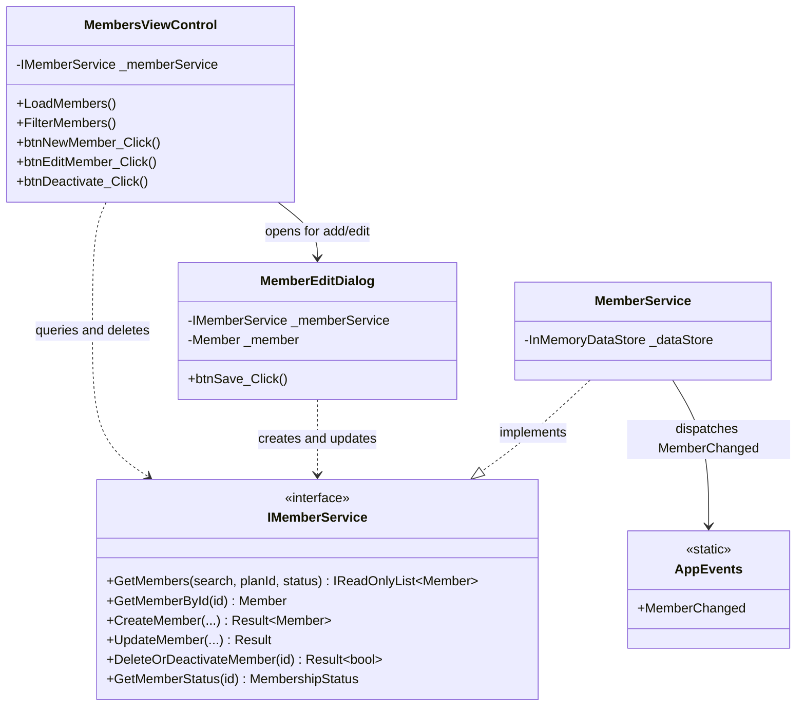

# Component 06: Members Management & Directory — Implementation Report

**Author / Subsystem**: Gym Management System (Windows Forms Core)  
**Component ID**: `06_members`  
**Related Requirements**: Requirements **D3**, **D6**, **D12**, **D13**, and Business Rule **8**  
**Status**: ✅ **Implemented and Verified**  

---

## 1. Executive Summary

Component 06 delivers member lifecycle management and an interactive directory for the Gym Management System. It allows administrators to register members, edit profile details, filter by plan and status, perform real-time text searches, and safely deactivate member accounts while strictly enforcing Business Rule 8 (preventing hard deletion of members with active or historical records).

---

## 2. Implemented Files & Directory Structure

```
GymMembershipSystem/
├── Services/
│   ├── Interfaces/
│   │   └── IMemberService.cs                # Service contract for member repository operations
│   └── MemberService.cs                     # Business logic, Rule 8 enforcement, and search/filter engine
└── Forms/
    └── Members/
        ├── MemberEditDialog.cs              # Modal dialog for member registration & profile editing
        ├── MemberEditDialog.Designer.cs     # Input layout, date pickers, validation error provider
        ├── MembersViewControl.cs            # Detailed ListView directory with multi-facet filtering
        └── MembersViewControl.Designer.cs   # Filter bar, search input, status badges, and action buttons
```

---

## 3. Architecture & Business Rules Enforced



### Business Rule Enforcement:
- **Business Rule 8**: If a member has existing subscriptions or payment records in `InMemoryDataStore`, `DeleteOrDeactivateMember` prevents physical removal and executes a soft deactivation (`IsActive = false`), returning a message that the member was deactivated instead of deleted.
- **Requirement D12 (Validation)**: Validates required full name, phone number, email syntax, and ensures date of birth results in age between 12 and 100 years.
- **Requirement D13 (Confirmation)**: Displays a confirmation dialog before deactivating any member account.

---

## 4. Verification

- All member registration, search, multi-faceted filtering, and Rule 8 deactivation guards compile cleanly and function properly in the running application.
