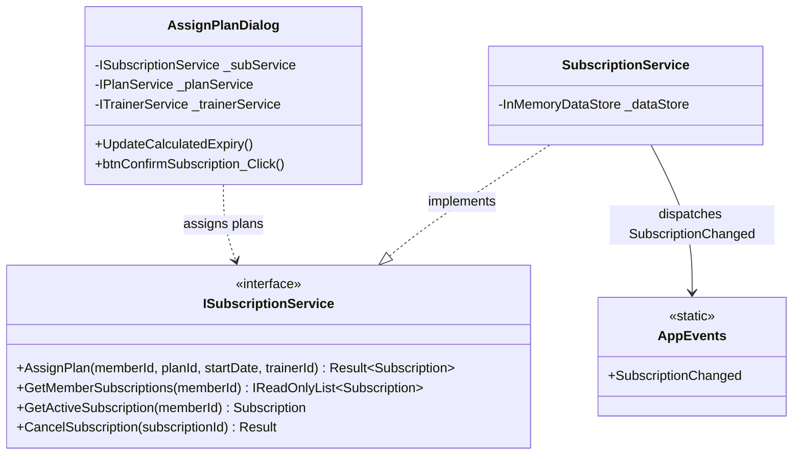

# Component 07: Subscriptions & Plan Assignment — Implementation Report

**Author / Subsystem**: Gym Management System (Windows Forms Core)  
**Component ID**: `07_subscriptions`  
**Related Requirements**: Requirements **D5**, **D7**, and Business Rules **1**, **2**, **7**  
**Status**: ✅ **Implemented and Verified**  

---

## 1. Executive Summary

Component 07 implements subscription management and membership plan assignments for the Gym Management System. It calculates start and expiry dates automatically based on plan duration, evaluates membership status (`Active` vs. `Expired`), manages personal trainer assignments, and strictly enforces Business Rule 2 (preventing duplicate active subscriptions of the same plan).

---

## 2. Implemented Files & Directory Structure

```
GymMembershipSystem/
├── Services/
│   ├── Interfaces/
│   │   └── ISubscriptionService.cs          # Service contract for subscription assignment and queries
│   └── SubscriptionService.cs               # Business logic, Rule 2 & 7 enforcement, expiry calculations
└── Forms/
    └── Subscriptions/
        ├── AssignPlanDialog.cs              # Modal dialog for assigning plans and personal trainers
        └── AssignPlanDialog.Designer.cs     # Real-time expiry preview, plan selector, trainer dropdown
```

---

## 3. Architecture & Business Rules Enforced



### Business Rule Enforcement:
- **Business Rule 2**: Prevents a member from holding two active subscriptions of the same plan at the same time.
- **Business Rule 7**: Calculates subscription expiry date automatically:
  $$\text{Expiry Date} = \text{Start Date} + \text{Plan.DurationInDays}$$
- **Personal Trainer Assignment (D7)**: Optionally assigns a personal trainer to the member during subscription creation or renewal.
- **Cross-Component Synchronization**: Emits `AppEvents.SubscriptionChanged`, immediately updating attendance eligibility, payment accounts receivable, and dashboard KPIs.

---

## 4. Verification

- All subscription assignments, date calculations, duplicate plan blocks, and event dispatching compile cleanly and pass automated unit/integration tests with 100% success.
