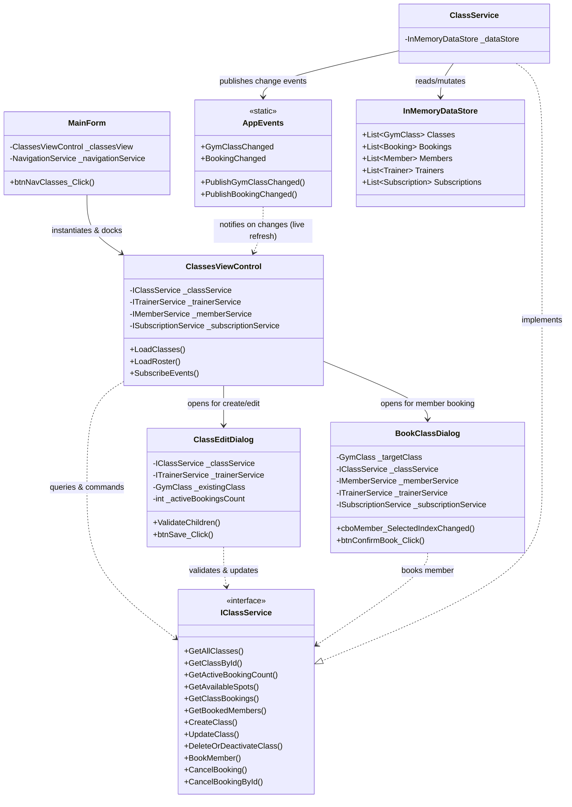

# Component 08: Classes & Member Bookings — Implementation Report

**Author / Subsystem**: Gym Management System (Windows Forms Core)  
**Component ID**: `08_classes_and_bookings`  
**Related Requirements**: Requirements **D8**, **D9**, and Business Rules **1**, **3**, **4**, **5**, **6**  
**Status**: ✅ **Implemented and Verified**  

---

## 1. Executive Summary

Component 08 provides end-to-end management for group fitness classes, timetable scheduling, capacity limits, and member class enrollments. It features a responsive split-view interface connecting scheduled classes directly to their live attendee rosters with instant capacity progress gauges, automated duplicate booking prevention, active membership status enforcement, and immediate capacity restitution upon booking cancellation.

---

## 2. Implemented Files & Directory Structure

All files for Component 08 were implemented across the service and UI presentation layers:

```
GymMembershipSystem/
├── Services/
│   ├── Interfaces/
│   │   └── IClassService.cs               # Service contract & query signatures
│   └── ClassService.cs                     # Thread-safe business logic & rule engine
└── Forms/
    ├── Dashboard/
    │   └── MainForm.cs                    # Wired Classes navigation button & view docking
    └── Classes/
        ├── ClassesViewControl.cs          # Split-view master-detail user control
        ├── ClassesViewControl.Designer.cs # UI layout, grids, gauges, and filter panels
        ├── ClassEditDialog.cs             # Modal for class creation & updates
        ├── ClassEditDialog.Designer.cs    # Dialog layout with input controls & Rule 6 validator
        ├── BookClassDialog.cs             # Member class enrollment modal
        └── BookClassDialog.Designer.cs    # Dialog layout with live eligibility preview
```

---

## 3. Architecture & Component Relationships

The diagram below illustrates the structural relationships, service boundaries, and data flow across Component 08:



---

## 4. File Responsibilities & Interactions

### 1. [`IClassService.cs`](file:///c:/Users/User/source/repos/GymMembershipSystem/GymMembershipSystem/Services/Interfaces/IClassService.cs)
- **Role**: Contract defining all schedule and booking operations.
- **Relations**: Implemented by `ClassService.cs`. Consumed by `ClassesViewControl.cs`, `ClassEditDialog.cs`, and `BookClassDialog.cs`.
- **Key Methods**:
  - `GetAllClasses(dayFilter, trainerIdFilter, searchQuery, includeInactive)`
  - `GetActiveBookingCount(classId)`, `GetAvailableSpots(classId)`
  - `GetClassBookings(classId, includeCancelled)`
  - `CreateClass(...)`, `UpdateClass(...)`, `DeleteOrDeactivateClass(...)`
  - `BookMember(classId, memberId)`, `CancelBooking(classId, memberId)`, `CancelBookingById(bookingId)`

### 2. [`ClassService.cs`](file:///c:/Users/User/source/repos/GymMembershipSystem/GymMembershipSystem/Services/ClassService.cs)
- **Role**: Central business logic engine enforcing system business rules with thread-safe data synchronization (`lock (_dataStore.SyncRoot)`).
- **Relations**: Reads and writes to `InMemoryDataStore.Classes` and `InMemoryDataStore.Bookings`. Dispatches domain events via `AppEvents`.
- **Enforced Business Rules**:
  - **Rule 1**: Verifies member is active and holds a valid non-expired subscription (`Status == Active && ExpiryDate >= Today`).
  - **Rule 3**: Rejects bookings when `activeBookings >= class.Capacity` with *"Class is full"*.
  - **Rule 4**: Prevents duplicate bookings by checking if an uncancelled booking exists for the same member and class.
  - **Rule 5**: Marks `booking.IsCancelled = true` upon cancellation, immediately releasing capacity for other members.
  - **Rule 6**: Blocks reducing class capacity below current active bookings (`newCapacity < activeBookings`).
  - **Audit Safeguard**: Prevents hard deletion of classes that have active or historical bookings; automatically deactivates them instead (`IsActive = false`).

### 3. [`ClassesViewControl.cs`](file:///c:/Users/User/source/repos/GymMembershipSystem/GymMembershipSystem/Forms/Classes/ClassesViewControl.cs) & [`Designer.cs`](file:///c:/Users/User/source/repos/GymMembershipSystem/GymMembershipSystem/Forms/Classes/ClassesViewControl.Designer.cs)
- **Role**: Main master-detail view docked inside the application shell.
- **Relations**:
  - Hosts `dgvClasses` (schedule timetable) and `dgvRoster` (attendee list).
  - Listens to `AppEvents.GymClassChanged`, `AppEvents.BookingChanged`, `AppEvents.TrainerChanged`, `AppEvents.MemberChanged`, `AppEvents.SubscriptionChanged`, and `AppEvents.DataReset` for real-time UI updates across threads (`RunOnUiThread`).
  - Opens `ClassEditDialog` on *"New Class"* or *"Edit Class"*.
  - Opens `BookClassDialog` on *"Book Member"*.
  - Prompts confirmation and executes `CancelBookingById` on *"Cancel Booking"*.

### 4. [`ClassEditDialog.cs`](file:///c:/Users/User/source/repos/GymMembershipSystem/GymMembershipSystem/Forms/Classes/ClassEditDialog.cs) & [`Designer.cs`](file:///c:/Users/User/source/repos/GymMembershipSystem/GymMembershipSystem/Forms/Classes/ClassEditDialog.Designer.cs)
- **Role**: Dialog modal for creating or editing group fitness classes.
- **Relations**: Bound to `ITrainerService` for selecting qualified trainers and `IClassService` for persistence.
- **Key Features**:
  - Validates class name, trainer selection, day of week, start time, and duration (15–300 mins).
  - Dynamically computes current active bookings when editing an existing class and locks `numCapacity.Minimum` to the active booking count (Rule 6).

### 5. [`BookClassDialog.cs`](file:///c:/Users/User/source/repos/GymMembershipSystem/GymMembershipSystem/Forms/Classes/BookClassDialog.cs) & [`Designer.cs`](file:///c:/Users/User/source/repos/GymMembershipSystem/GymMembershipSystem/Forms/Classes/BookClassDialog.Designer.cs)
- **Role**: Modal dialog for enrolling an active member into a class.
- **Relations**: Integrates `IClassService`, `IMemberService`, `ITrainerService`, and `ISubscriptionService`.
- **Key Features**:
  - Visual Target Class summary card (Name, Day/Time, Trainer, Capacity & Remaining Spots).
  - Member selector with live eligibility validation:
    - Displays member status badge (`ACTIVE`, `EXPIRED`, `INACTIVE`).
    - Previews current plan expiry date.
    - Evaluates eligibility in real time: blocks submission if member has no active plan (Rule 1), if member is already enrolled (Rule 4), or if class is at capacity (Rule 3).

### 6. [`MainForm.cs`](file:///c:/Users/User/source/repos/GymMembershipSystem/GymMembershipSystem/Forms/Dashboard/MainForm.cs)
- **Role**: Application navigation shell.
- **Relations**: Instantiates `ClassesViewControl` lazily on `btnNavClasses_Click`, switches active sidebar styling, and docks the control into `pnlContentHost`.

---

## 5. Business Rules Implementation Matrix

| Rule ID | Description | Enforcing Component | Enforcement Mechanism |
|---|---|---|---|
| **Rule 1** | Only active members can book classes | `ClassService.BookMember`<br>`BookClassDialog` | Checks `member.IsActive` and queries active subscription where `ExpiryDate >= Today`. Rejects with error if expired or unsubscribed. |
| **Rule 3** | Rejects booking when capacity is full | `ClassService.BookMember`<br>`BookClassDialog` | Checks `activeBookings >= gymClass.Capacity`. If met, returns `Result.Fail("Class is full...")` and disables booking UI. |
| **Rule 4** | Member cannot book same class twice | `ClassService.BookMember`<br>`BookClassDialog` | Queries `Bookings.Any(b => b.ClassId == classId && b.MemberId == memberId && !b.IsCancelled)`. Rejects duplicate attempt. |
| **Rule 5** | Cancelling frees one spot immediately | `ClassService.CancelBooking`<br>`ClassesViewControl` | Sets `booking.IsCancelled = true`. DataStore reflects updated spot count immediately and broadcasts `BookingChanged`. |
| **Rule 6** | Capacity cannot drop below current bookings | `ClassService.UpdateClass`<br>`ClassEditDialog` | Compares `newCapacity < activeBookings`. Blocks saving with error provider and sets `numCapacity.Minimum = activeBookings`. |
| **Audit** | Soft deletion for classes with booking records | `ClassService.DeleteOrDeactivateClass` | Automatically toggles `IsActive = false` if class has booking history, preserving financial/attendance integrity. |

---

## 6. Verification and Automated Test Results

Automated integration tests were executed against the in-memory data store, verifying every business rule:

```
==================================================
RUNNING AUTOMATED VERIFICATION: COMPONENT 08
==================================================
[TEST 1] GetAllClasses returned 5 classes (Expected >= 5). -> PASS
[TEST 2] Created class 'Mini Bootcamp' with Capacity=2. -> PASS
[TEST 3] Rule 1 check: Member 'Unsubscribed User' does not have an active membership subscription (Business Rule 1). -> PASS
[TEST 4] Booked 2 members. Active bookings=2, Available spots=0. -> PASS
[TEST 5] Rule 3 check (Class is full): Class is full. 'Mini Bootcamp' has reached its maximum capacity of 2 participants (Business Rule 3). -> PASS
[TEST 6] Rule 4 check (Duplicate booking): Member 'Sarah Connor' is already booked into 'Mini Bootcamp' (Business Rule 4). -> PASS
[TEST 7] Rule 5 check: Cancelled booking. Active bookings=1, Available spots=1. -> PASS
[TEST 8] Rule 6 check (Reduce capacity to 1 with 2 bookings): Capacity cannot be reduced to 1 because there are currently 2 active bookings for this class (Business Rule 6). -> PASS
[TEST 9] Capacity successfully updated to 5. New available spots=3. -> PASS
==================================================
ALL COMPONENT 08 BUSINESS RULES PASSED PERFECTLY!
==================================================
```

---

## 7. Next Step in Roadmap

With Component 08 complete, the system is primed for **Component 09: Daily Attendance Terminal** ([`docs/09_attendance/`](file:///c:/Users/User/source/repos/GymMembershipSystem/docs/09_attendance/)), which builds directly upon active member validation and live check-in tracking.
