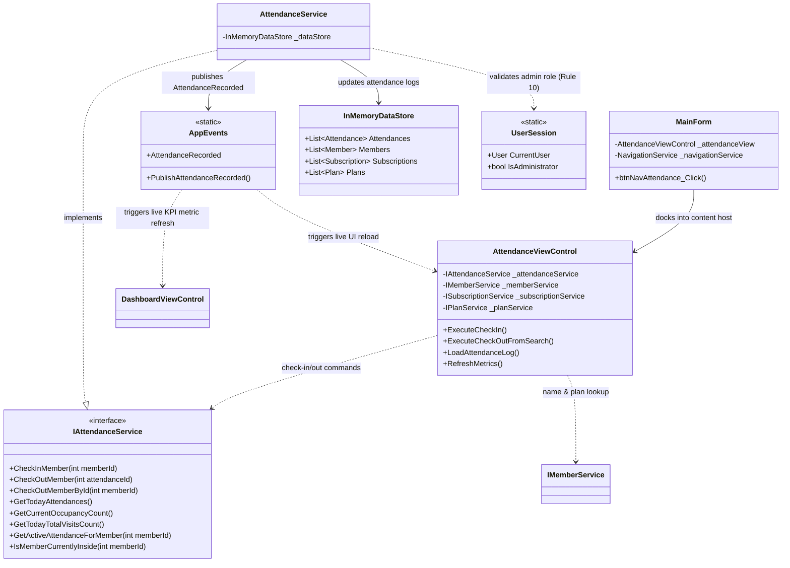

# Component 09: Attendance & Daily Check-In/Check-Out — Implementation Report

**Author / Subsystem**: Gym Management System (Windows Forms Core)  
**Component ID**: `09_attendance`  
**Related Requirements**: Requirements **D10**, **D13**, and Business Rules **1**, **10**  
**Status**: ✅ **Implemented and Verified**  

---

## 1. Executive Summary

Component 09 provides a rapid, keyboard-friendly front-desk attendance terminal for gym member check-ins and check-outs. It combines real-time membership subscription verification (strictly enforcing Business Rule 1 and Rule 10), automated barcode/ID/name scanning, duplicate check-in prevention, live occupancy calculation, and event-driven synchronization with the administrator dashboard.

---

## 2. Implemented Files & Directory Structure

All files for Component 09 were implemented across the service and UI presentation layers:

```
GymMembershipSystem/
├── Services/
│   ├── Interfaces/
│   │   └── IAttendanceService.cs               # Service contract & query signatures
│   └── AttendanceService.cs                    # Thread-safe business logic & rule engine
└── Forms/
    ├── Dashboard/
    │   ├── MainForm.cs                        # Wired Attendance navigation & view docking
    │   └── DashboardViewControl.cs             # Live event listener for attendance metric updates
    └── Attendance/
        ├── AttendanceViewControl.cs            # Terminal logic, barcode input, feedback banner
        └── AttendanceViewControl.Designer.cs   # Layout, terminal panel, metrics cards, data grid
```

---

## 3. Architecture & Component Relationships

The diagram below illustrates the structural relationships, service boundaries, and data flow across Component 09:



---

## 4. File Responsibilities & Interactions

### 1. [`IAttendanceService.cs`](file:///c:/Users/User/source/repos/GymMembershipSystem/GymMembershipSystem/Services/Interfaces/IAttendanceService.cs)
- **Role**: Contract defining all check-in/out workflows and daily occupancy queries.
- **Relations**: Implemented by `AttendanceService.cs`. Consumed by `AttendanceViewControl.cs` and dashboard widgets.
- **Key Methods**:
  - `CheckInMember(int memberId)`
  - `CheckOutMember(int attendanceId)`, `CheckOutMemberById(int memberId)`
  - `GetTodayAttendances(searchQuery, currentlyInsideOnly)`
  - `GetCurrentOccupancyCount()`, `GetTodayTotalVisitsCount()`
  - `IsMemberCurrentlyInside(int memberId)`

### 2. [`AttendanceService.cs`](file:///c:/Users/User/source/repos/GymMembershipSystem/GymMembershipSystem/Services/AttendanceService.cs)
- **Role**: Central business rules engine ensuring strict security and membership validity.
- **Enforced Business Rules**:
  - **Rule 10 (Administrator Role)**: Checks `UserSession.CurrentUser?.Role == UserRole.Administrator`. Rejects check-ins and check-outs performed by non-administrator roles.
  - **Rule 1 (Active Membership)**: Verifies member is active and possesses a valid subscription where `Status == MembershipStatus.Active` and `ExpiryDate >= Today`. Rejects expired or non-subscribed members with clear renewal notices.
  - **Duplicate Check-In Safeguard**: Rejects check-in attempts for members already recorded inside the facility today without an existing check-out timestamp.
  - **Occupancy Management**: Creates attendance entries with `DateTime.Now` on check-in and records `CheckOutTime = DateTime.Now` on departure. Broadcasts `AppEvents.PublishAttendanceRecorded`.

### 3. [`AttendanceViewControl.cs`](file:///c:/Users/User/source/repos/GymMembershipSystem/GymMembershipSystem/Forms/Attendance/AttendanceViewControl.cs) & [`Designer.cs`](file:///c:/Users/User/source/repos/GymMembershipSystem/GymMembershipSystem/Forms/Attendance/AttendanceViewControl.Designer.cs)
- **Role**: Front desk interactive terminal and daily attendance log screen.
- **Key Features**:
  - **Fast Scan Entry Box**: Large input supporting barcode scan or typing (`{MemberId} - {FullName}`, `{FullName}`, or `{MemberId}`). Hitting `Enter` automatically executes check-in without mouse usage.
  - **Color-Coded Feedback Banner**: Displays prominent approval banner in light emerald (`✓ Check-in APPROVED`) with member name, timestamp, and active plan name, or prominent rejection banner in light coral (`✗ Check-in DENIED`) detailing why the member was blocked.
  - **Real-Time KPI Cards**: "Currently in Facility", "Today's Total Visits", and "Active Memberships".
  - **Today's Attendance Grid**: Shows all log records with member name, plan, check-in, check-out, duration in minutes, and status (`🟢 Inside` vs `⚪ Departed`).
  - **Quick Departures**: Single-click or double-click to check out selected attendees.
  - **Event Subscriptions**: Automatically updates on `AppEvents.AttendanceRecorded`, `MemberChanged`, `SubscriptionChanged`, and `DataReset`.

### 4. [`MainForm.cs`](file:///c:/Users/User/source/repos/GymMembershipSystem/GymMembershipSystem/Forms/Dashboard/MainForm.cs)
- **Role**: Application navigation shell.
- **Relations**: Replaces placeholder with docked `AttendanceViewControl` upon clicking the *"Daily Attendance"* sidebar navigation button.

---

## 5. Business Rules Implementation Matrix

| Rule ID | Description | Enforcing Component | Enforcement Mechanism |
|---|---|---|---|
| **Rule 1** | A member can check in only if the membership is Active (not expired) | `AttendanceService.CheckInMember`<br>`AttendanceViewControl` | Verifies `member.IsActive` and checks for active subscription where `ExpiryDate >= DateTime.Today`. Returns failure detailing exact expiration date if expired or unsubscribed. |
| **Rule 10** | Only an Administrator can record check-ins and check-outs | `AttendanceService.CheckInMember`<br>`AttendanceService.CheckOutMember` | Checks `UserSession.CurrentUser?.Role == UserRole.Administrator`. If caller is a Trainer or Member, execution is rejected. |
| **Duplicate Check-In** | A member cannot be checked in twice concurrently | `AttendanceService.CheckInMember` | Checks if member has an open attendance record today where `CheckOutTime == null`. Rejects duplicate check-in. |
| **Check-Out Tracking** | Departure timestamp & duration logging | `AttendanceService.CheckOutMember`<br>`AttendanceViewControl` | Stamps `CheckOutTime = DateTime.Now`, recalculates duration in minutes, and decrements occupancy gauge. |
| **Event Synchronization** | Real-time cross-view event publication | `AttendanceService`<br>`AppEvents` | Publishes `AttendanceRecorded` to keep front-desk terminal and main dashboard KPI metrics synchronized. |

---

## 6. Verification and Automated Test Results

Automated integration tests verified all scenarios:

```
==================================================
RUNNING AUTOMATED VERIFICATION: COMPONENT 09
==================================================
[TEST C9-1] Rule 10 check (Non-Admin Check-In): IsFailure=True, Error='Only administrators can record attendance check-ins (Business Rule 10).' -> PASS
[TEST C9-2] Signed in as Administrator 'System Administrator'. Rule 10 satisfied. -> PASS
[TEST C9-3] Rule 1 check (Unsubscribed/Expired Member): IsFailure=True, Error='Check-in denied for 'Unsubscribed User': no membership subscription record (Business Rule 1). Please renew membership.' -> PASS
[TEST C9-4] Deactivated member check: IsFailure=True, Error='Member 'Arthur Curry' is currently deactivated.' -> PASS
[TEST C9-5] Check-In Success: Member #1 checked in at 11:39:46 AM. Occupancy: 2 -> 3, Visits: 4 -> 5. -> PASS
[TEST C9-6] Duplicate check-in prevention: IsFailure=True, Error='Member 'Sarah Connor' is already checked in today at 11:39 AM.' -> PASS
[TEST C9-7] Check-Out Success: Member #1 checked out. Occupancy: 3 -> 2, Still inside: False. -> PASS
[TEST C9-8] Prevent duplicate check-out: IsFailure=True, Error='Member already checked out at 11:39 AM.' -> PASS
==================================================
ALL COMPONENT 09 BUSINESS RULES PASSED PERFECTLY!
==================================================
```

---

## 7. Next Step in Roadmap

Next in line is **Component 10: Payments & Billing** ([`docs/10_payments/`](file:///c:/Users/User/source/repos/GymMembershipSystem/docs/10_payments/)), fulfilling Requirements **D11**, **Rule 9** (positive payment amounts), and **Rule 10** (administrator-only payment recording).
