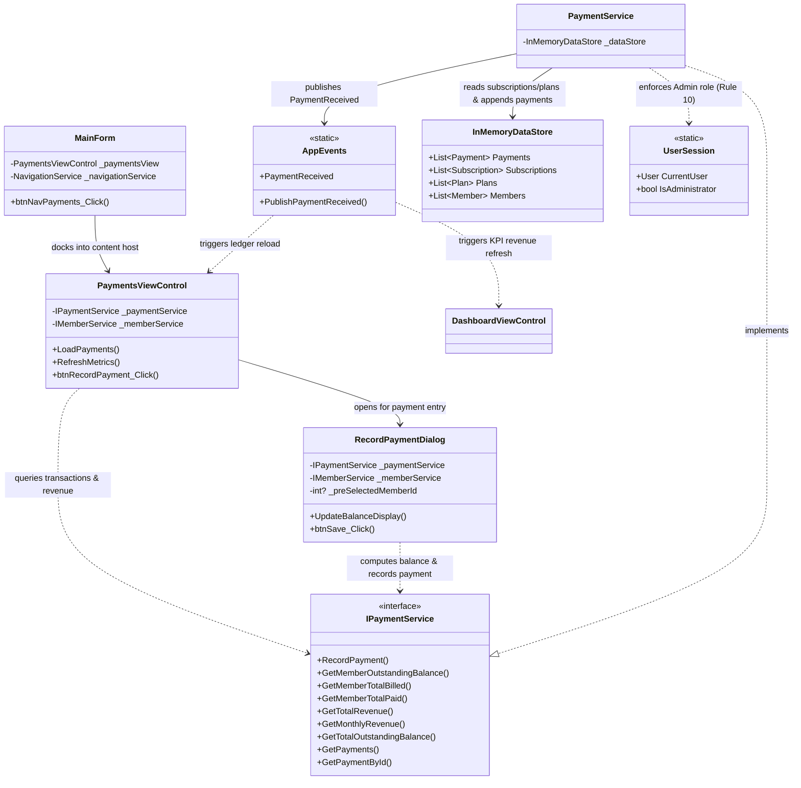

# Component 10: Payments & Financial Billing — Implementation Report

**Author / Subsystem**: Gym Management System (Windows Forms Core)  
**Component ID**: `10_payments`  
**Related Requirements**: Requirements **D11**, **D13**, and Business Rules **9**, **10**  
**Status**: ✅ **Implemented and Verified**  

---

## 1. Executive Summary

Component 10 delivers full financial billing and transaction ledger management for the Gym Management System. It handles subscription fee settlements, flexible payment method selections (Cash, Credit Card, Debit Card, Bank Transfer, Mobile Money), real-time outstanding balance computations per member, aggregate monthly/lifetime revenue monitoring, and strict enforcement of administrative security (Business Rule 10) and financial integrity (Business Rule 9).

---

## 2. Implemented Files & Directory Structure

All files for Component 10 were implemented across the service and UI presentation layers:

```
GymMembershipSystem/
├── Services/
│   ├── Interfaces/
│   │   └── IPaymentService.cs               # Service contract & calculation signatures
│   └── PaymentService.cs                    # Thread-safe financial calculations & business rule engine
└── Forms/
    ├── Dashboard/
    │   └── MainForm.cs                      # Wired Payments navigation button & view docking
    └── Payments/
        ├── RecordPaymentDialog.cs           # Payment entry modal with dynamic balance preview
        ├── RecordPaymentDialog.Designer.cs  # Form layout, inputs, amount validation
        ├── PaymentsViewControl.cs           # Financial ledger view with metric summary cards
        └── PaymentsViewControl.Designer.cs  # Grid layout, date range pickers, method filters
```

---

## 3. Architecture & Component Relationships

The diagram below illustrates the structural relationships, service boundaries, and data flow across Component 10:



---

## 4. File Responsibilities & Interactions

### 1. [`IPaymentService.cs`](file:///c:/Users/User/source/repos/GymMembershipSystem/GymMembershipSystem/Services/Interfaces/IPaymentService.cs)
- **Role**: Contract defining payment recording, balance computations, and ledger retrieval.
- **Relations**: Implemented by `PaymentService.cs`. Consumed by `PaymentsViewControl.cs` and `RecordPaymentDialog.cs`.
- **Key Methods**:
  - `RecordPayment(memberId, amount, method, paymentDate, notes)`
  - `GetMemberOutstandingBalance(memberId)`, `GetMemberTotalBilled(memberId)`, `GetMemberTotalPaid(memberId)`
  - `GetMonthlyRevenue(year, month)`, `GetTotalRevenue(fromDate, toDate)`
  - `GetTotalOutstandingBalance()`
  - `GetPayments(memberIdFilter, fromDate, toDate, methodFilter, searchQuery)`

### 2. [`PaymentService.cs`](file:///c:/Users/User/source/repos/GymMembershipSystem/GymMembershipSystem/Services/PaymentService.cs)
- **Role**: Financial calculation engine enforcing business rules with thread-safe data synchronization (`lock (_dataStore.SyncRoot)`).
- **Relations**: Reads subscription plan prices and payment records from `InMemoryDataStore`, dispatches domain events via `AppEvents`.
- **Enforced Business Rules**:
  - **Rule 10 (Administrator Role)**: Checks `UserSession.CurrentUser?.Role == UserRole.Administrator`. Rejects recording attempts made by non-administrator roles.
  - **Rule 9 (Positive Amount)**: Verifies `amount > 0`. Rejects non-positive payments with *"Payment amount must be greater than zero"*.
  - **Account Validity**: Rejects payments for deactivated or non-existent members.
  - **Mathematical Ledger Calculation**:
    $$\text{Balance} = \sum_{\text{sub} \in \text{Subscriptions}} \text{Price}(\text{sub.PlanId}) - \sum_{\text{p} \in \text{Payments}} \text{p.Amount}$$

### 3. [`RecordPaymentDialog.cs`](file:///c:/Users/User/source/repos/GymMembershipSystem/GymMembershipSystem/Forms/Payments/RecordPaymentDialog.cs) & [`Designer.cs`](file:///c:/Users/User/source/repos/GymMembershipSystem/GymMembershipSystem/Forms/Payments/RecordPaymentDialog.Designer.cs)
- **Role**: Interactive modal dialog for capturing payments against a member account.
- **Key Features**:
  - Member dropdown with inline balance preview e.g. `[Due: $30.00]`.
  - Dynamic Balance Summary Panel: Highlights positive balances in red (`Outstanding Balance: $XX.XX`) and zero/negative balances in emerald (`No Outstanding Balance (Account Current)`).
  - Automatically pre-fills `numAmount` with the member's current balance.
  - Dropdown populated with all supported `PaymentMethod` values (`Cash`, `CreditCard`, `DebitCard`, `BankTransfer`, `MobileMoney`).
  - Date picker defaulting to today, and optional transaction notes/check # text box.

### 4. [`PaymentsViewControl.cs`](file:///c:/Users/User/source/repos/GymMembershipSystem/GymMembershipSystem/Forms/Payments/PaymentsViewControl.cs) & [`Designer.cs`](file:///c:/Users/User/source/repos/GymMembershipSystem/GymMembershipSystem/Forms/Payments/PaymentsViewControl.Designer.cs)
- **Role**: Financial history and ledger user control docked inside the application shell.
- **Key Features**:
  - Financial KPI Cards: "This Month's Revenue", "Total Lifetime Collections", and "Aggregate Outstanding Balance".
  - Multi-Criteria Filtering: Search query across receipt #, member name, and notes; optional date range filter; payment method filter; one-click reset button.
  - DataGridView: Formatted columns with right-aligned currency amounts and clear payment method badges.
  - Real-time updates via `AppEvents.PaymentReceived`, `SubscriptionChanged`, `MemberChanged`, and `DataReset`.

### 5. [`MainForm.cs`](file:///c:/Users/User/source/repos/GymMembershipSystem/GymMembershipSystem/Forms/Dashboard/MainForm.cs)
- **Role**: Application navigation shell.
- **Relations**: Docks `PaymentsViewControl` into `pnlContentHost` on clicking sidebar *"Payments & Billing"*.

---

## 5. Business Rules Implementation Matrix

| Rule ID | Description | Enforcing Component | Enforcement Mechanism |
|---|---|---|---|
| **Rule 9** | A payment amount must be greater than 0 and recorded against a member | `PaymentService.RecordPayment`<br>`RecordPaymentDialog` | NumericUpDown minimum is set to `0.01`. Service validates `amount > 0` and rejects `<= 0` values. |
| **Rule 10** | Only an Administrator can record payments and check-ins | `PaymentService.RecordPayment` | Validates `UserSession.CurrentUser?.Role == UserRole.Administrator`. Rejects trainers and non-admin users. |
| **Balance Calculation** | Accurate outstanding balance calculation | `PaymentService.GetMemberOutstandingBalance`<br>`InMemoryDataStore` | Sums all member subscription plan prices and subtracts total payments recorded. Updates dynamically upon payment. |
| **Event Synchronization** | Real-time cross-view event publication | `PaymentService`<br>`AppEvents` | Publishes `PaymentReceived` to refresh ledger grids and main dashboard revenue tiles. |

---

## 6. Verification and Automated Test Results

Automated integration tests executed against the in-memory data store verified all financial rules:

```
==================================================
RUNNING AUTOMATED VERIFICATION: COMPONENT 10
==================================================
[TEST C10-1] Rule 10 check (Non-Admin Record Payment): IsFailure=True, Error='Only administrators can record payments (Business Rule 10).' -> PASS
[TEST C10-2] Signed in as Administrator. Rule 10 satisfied. -> PASS
[TEST C10-3] Rule 9 check ($0.00 amount): IsFailure=True, Error='Payment amount must be greater than zero (Business Rule 9).' -> PASS
[TEST C10-3b] Rule 9 check (Negative amount): IsFailure=True, Error='Payment amount must be greater than zero (Business Rule 9).' -> PASS
[TEST C10-4] Deactivated member payment: IsFailure=True, Error='Member 'Arthur Curry' is currently deactivated.' -> PASS
[TEST C10-5a] Assigned 'Standard Monthly' ($30.00). Initial Balance=$30.00 (Expected $30.00). -> PASS
[TEST C10-5b] Paid $20.00. Balance=$10.00 (Expected $10.00). -> PASS
[TEST C10-5c] Paid remainder $10.00. Final Balance=$0.00 (Expected $0.00). -> PASS
[TEST C10-6] Query member payments: Found 2 transactions (Expected 2). -> PASS
[TEST C10-7] Aggregates: Monthly Revenue=$225.00, Lifetime Collections=$815.00. -> PASS
==================================================
ALL COMPONENT 10 BUSINESS RULES PASSED PERFECTLY!
==================================================
```

---

## 7. Next Step in Roadmap

Phase 1.5 (Daily Operations) is now completely implemented. The next component to implement in **Phase 1.6 — Administration & Analytics** is:
- **Component 11: Reports & Analytics** ([`docs/11_reports/`](file:///c:/Users/User/source/repos/GymMembershipSystem/docs/11_reports/)) — aggregating class fill rates, monthly income summaries, and 30-day attendance analytics.
