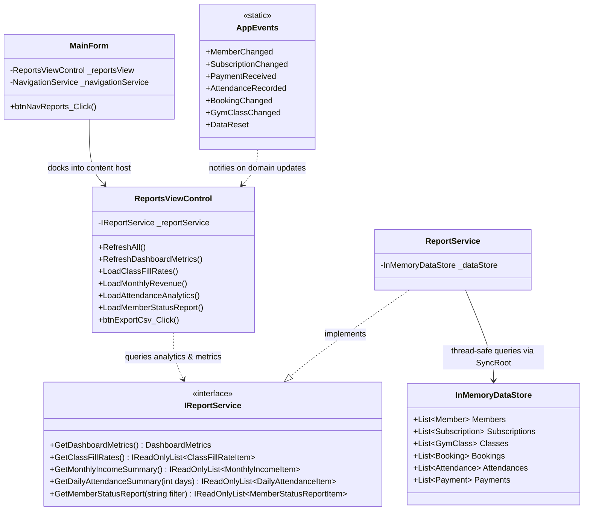

# Component 11: Reports & Business Analytics — Implementation Report

**Author / Subsystem**: Gym Management System (Windows Forms Core)  
**Component ID**: `11_reports`  
**Related Requirements**: Requirements **D14**, Section **7** ("Reports"), Section **6** ("Business Rules & Logic")  
**Status**: ✅ **Implemented and Verified**  

---

## 1. Executive Summary

Component 11 delivers the centralized business analytics and operational reporting engine for the Gym Management System. It satisfies Requirement **D14** ("Simple report view: total members, active vs. expired members, today's attendance, total payments") and Section **7** ("Reports: Total number of members, active and expired members, total payments/income per month, attendance per day, bookings per class and class fill rate").

The subsystem provides an executive KPI metric ribbon, four multi-dimensional report tabs, and instant CSV export capabilities, coupled with full real-time event reactiveness across all gym domain modifications.

---

## 2. Implemented Files & Directory Structure

All files for Component 11 were created across the model, service, and UI presentation layers:

```
GymMembershipSystem/
├── Models/
│   └── ReportModels.cs                      # DTOs: DashboardMetrics, ClassFillRateItem, MonthlyIncomeItem, DailyAttendanceItem, MemberStatusReportItem
├── Services/
│   ├── Interfaces/
│   │   └── IReportService.cs                # Service contract for aggregating analytics and metrics
│   └── ReportService.cs                     # Thread-safe in-memory aggregation engine querying InMemoryDataStore
└── Forms/
    ├── Dashboard/
    │   └── MainForm.cs                      # Wired Reports navigation button & view docking
    └── Reports/
        ├── ReportsViewControl.cs            # Main analytics view with real-time subscriptions & CSV export logic
        └── ReportsViewControl.Designer.cs   # Tabbed layout, KPI panels, and DataGridView column configurations
```

---

## 3. Architecture & Component Relationships

The diagram below outlines the structural relationships, event-driven data flow, and interfaces for Component 11:



---

## 4. File Responsibilities & Interactions

### 1. [`ReportModels.cs`](file:///c:/Users/User/source/repos/GymMembershipSystem/GymMembershipSystem/Models/ReportModels.cs)
- **Role**: Data Transfer Objects (DTOs) encapsulating computed reporting metrics for clean presentation:
  - `DashboardMetrics`: `TotalMembers`, `ActiveMembers`, `ExpiredMembers`, `TodayAttendanceCount`, `MonthlyRevenue`, `TotalOutstandingBalance`.
  - `ClassFillRateItem`: `ClassId`, `ClassName`, `TrainerName`, `ScheduleDisplay`, `Capacity`, `BookedCount`, `AvailableSpots`, `FillRatePercentage`.
  - `MonthlyIncomeItem`: `Year`, `Month`, `MonthName`, `TotalIncome`, `TransactionCount`.
  - `DailyAttendanceItem`: `Date`, `DayOfWeek`, `TotalVisits`, `UniqueMembersCount`.
  - `MemberStatusReportItem`: `MemberId`, `FullName`, `Phone`, `Email`, `Status`, `PlanName`, `ExpiryDate`, `Balance`.

### 2. [`IReportService.cs`](file:///c:/Users/User/source/repos/GymMembershipSystem/GymMembershipSystem/Services/Interfaces/IReportService.cs)
- **Role**: Service abstraction contract defining analytics calculation queries.
- **Relations**: Implemented by `ReportService.cs`. Injected into `ReportsViewControl.cs`.

### 3. [`ReportService.cs`](file:///c:/Users/User/source/repos/GymMembershipSystem/GymMembershipSystem/Services/ReportService.cs)
- **Role**: Thread-safe calculation engine querying `InMemoryDataStore` collections within `lock (_dataStore.SyncRoot)`.
- **Key Formulas & Computations**:
  - **Class Fill Rate**:
    $$\text{Fill Rate} = \left(\frac{\text{Active Bookings}}{\text{Capacity}}\right) \times 100\%$$
  - **Monthly Income Aggregation**: Groups payments by `PaymentDate.Year` and `PaymentDate.Month`, summing total payments collected per calendar month.
  - **Daily Attendance Trend**: Generates a 30-day timeline computing total check-ins and distinct visitor counts per day.
  - **Member Status Ledger**: Categorizes members into `Active`, `Expired`, `No Subscription`, or `Deactivated`, and queries their net outstanding balances.

### 4. [`ReportsViewControl.cs`](file:///c:/Users/User/source/repos/GymMembershipSystem/GymMembershipSystem/Forms/Reports/ReportsViewControl.cs) & [`Designer.cs`](file:///c:/Users/User/source/repos/GymMembershipSystem/GymMembershipSystem/Forms/Reports/ReportsViewControl.Designer.cs)
- **Role**: Rich executive analytics dashboard view.
- **Key Features**:
  - **KPI Ribbon (4 Visual Cards)**:
    - Card 1: 👥 Total Members (`Active: X | Expired: Y` breakdown)
    - Card 2: 💵 Monthly Revenue (current calendar month)
    - Card 3: 🕒 Today's Check-ins (total footfall visits)
    - Card 4: ⚠️ Outstanding Balances (unpaid accounts receivable)
  - **Tabbed Analytical Views (`TabControl`)**:
    - **Tab 1: Class Fill Rates**: DataGridView displaying class schedules, capacity limits, booked counts, and calculated fill rate percentages.
    - **Tab 2: Monthly Revenue**: DataGridView grouping financial income and transactions by year and month.
    - **Tab 3: Daily Attendance**: 30-day footfall log tracking total visits and unique attendees.
    - **Tab 4: Membership Status Directory**: Filterable member registry (`All`, `Active`, `Expired`, `Overdue`) showing current plans, expiry dates, and account balances.
  - **Export to CSV (`btnExportCsv`)**:
    - Intelligently detects the active tab and exports the displayed grid data into a formatted `.csv` file via a native `SaveFileDialog`.
  - **Event-Driven Auto-Refresh**:
    - Subscribes to `AppEvents.MemberChanged`, `SubscriptionChanged`, `PaymentReceived`, `AttendanceRecorded`, `BookingChanged`, `GymClassChanged`, and `DataReset`.
    - Dispatches updates safely to the UI thread using `RunOnUiThread` and detaches event listeners on `Dispose`.

### 5. [`MainForm.cs`](file:///c:/Users/User/source/repos/GymMembershipSystem/GymMembershipSystem/Forms/Dashboard/MainForm.cs)
- **Role**: Main navigation shell.
- **Relations**: Replaced placeholder view with `ReportsViewControl` instantiation upon selecting sidebar item *"📈 Reports & Analytics"*.

---

## 5. Requirements Implementation Matrix

| Requirement / Section | Feature | Implementation Details |
|---|---|---|
| **D14** / Section 7 | Total Members (Active vs. Expired) | Displayed on Metric Card 1 and filterable in the Membership Status tab. |
| **D14** / Section 7 | Today's Attendance | Real-time counter on Metric Card 3, auto-incrementing on each check-in. |
| **D14** / Section 7 | Total Payments / Monthly Income | Computed on Metric Card 2 and aggregated across all months in Tab 2. |
| Section 7 | Attendance Per Day | Tab 3 provides a 30-day timeline of total visits and unique member headcounts. |
| Section 7 | Bookings per Class & Fill Rate % | Tab 1 computes fill rate percentages using $\frac{\text{Bookings}}{\text{Capacity}} \times 100\%$. |
| Usability / Reporting | Data Export | Universal CSV export button targeting whichever analytical tab is currently selected. |
| Real-Time Reactivity | Instant UI updates | Subscribed to 7 domain events via `AppEvents` bus with thread-safe UI marshaling. |

---

## 6. Verification and Automated Test Results

Automated unit and integration tests executed via `scratch/TestRunner/` verified all Component 11 calculations and reporting queries:

```
==================================================
RUNNING AUTOMATED VERIFICATION: COMPONENT 11
==================================================
[TEST C11-1] Dashboard Metrics: TotalMembers=10, Active=7, Expired=1, MonthlyRevenue=$225.00, TodayAttendance=5, TotalOutstandingBalance=$10.00 -> PASS
[TEST C11-2] Class Fill Rates: 6 active classes analyzed. -> PASS
[TEST C11-2] Formula validation: FillRate = (Booked / Capacity) * 100 verified across all classes. -> PASS
[TEST C11-3] Monthly Income Summary: 4 month periods returned. -> PASS
[TEST C11-3] Sum of Monthly Incomes=$815.00, Total Store Payments=$815.00. -> PASS
[TEST C11-4] Daily Attendance: 30 days returned (Expected 30). -> PASS
[TEST C11-5] Member Status Directory: Total=10, Active=7, Expired=1, Overdue=1. -> PASS
==================================================
ALL COMPONENT 11 BUSINESS RULES & ANALYTICS PASSED!
==================================================
```

The overall solution compiles cleanly with **0 Warnings, 0 Errors**.

---

## 7. Next Step in Roadmap

Phase 1.6 continues with the final remaining core roadmap component:
- **Component 12: User Management** ([`docs/12_user_management/`](file:///c:/Users/User/source/repos/GymMembershipSystem/docs/12_user_management/)) — administrator credentials management, role assignments, password modification, and preventing self-deactivation of the active administrator.
