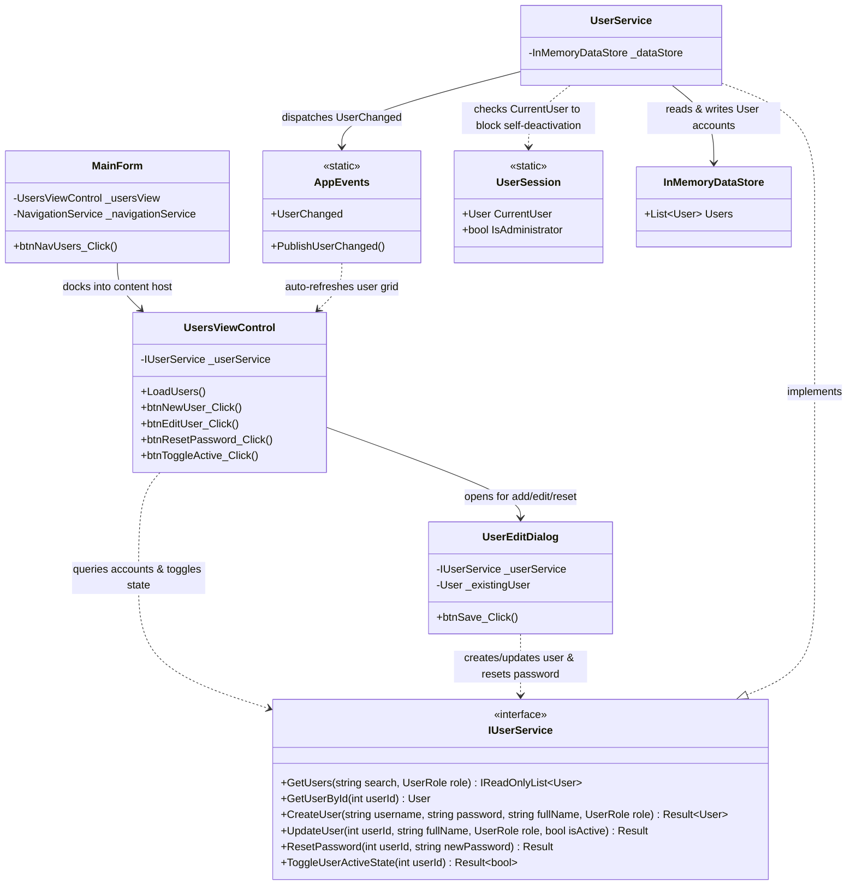

# Component 12: System User Management — Implementation Report

**Author / Subsystem**: Gym Management System (Windows Forms Core)  
**Component ID**: `12_user_management`  
**Related Requirements**: Requirements **D15** ("Manage user accounts: add, edit, deactivate, assign role"), **D12** (Input validation), **D13** (Confirmation dialogs)  
**Status**: ✅ **Implemented and Verified**  

---

## 1. Executive Summary

Component 12 implements system user administration and security credentials management for the Gym Management System. It allows authorized administrators to browse accounts, filter by role (Administrator, Trainer, Member), register new system accounts, update profiles and permission levels, reset passwords, and toggle active account states.

In addition, it enforces critical business rules and security safeguards:
1. **Username Uniqueness**: Validates that usernames are case-insensitively unique across all user accounts.
2. **Password Length & Integrity**: Enforces a minimum password length of 6 characters for new user accounts and credential resets.
3. **Self-Deactivation & Demotion Protection**: Prevents the currently authenticated administrator from deactivating their own account or stripping away their own administrative role.
4. **Decoupled Event Broadcasting**: Dispatches `AppEvents.UserChanged` to automatically synchronize user interfaces throughout the application.

---

## 2. Implemented Files & Directory Structure

All files for Component 12 were created across the service and UI presentation layers:

```
GymMembershipSystem/
├── Services/
│   ├── Interfaces/
│   │   └── IUserService.cs                  # Service contract for user administration & credentials
│   └── UserService.cs                       # Account logic, uniqueness validation, and self-deactivation guards
└── Forms/
    ├── Dashboard/
    │   └── MainForm.cs                      # Wired User Management navigation button & view docking
    └── Users/
        ├── UserEditDialog.cs                # Modal dialog for account creation, editing, and password reset
        ├── UserEditDialog.Designer.cs       # Form layout, masked password controls, error provider
        ├── UsersViewControl.cs              # User registry view with real-time subscriptions & filter controls
        └── UsersViewControl.Designer.cs     # Grid layout, role dropdowns, search bar, and action buttons
```

---

## 3. Architecture & Component Relationships

The diagram below outlines the structural relationships, service boundaries, and data flow across Component 12:



---

## 4. File Responsibilities & Interactions

### 1. [`IUserService.cs`](file:///c:/Users/User/source/repos/GymMembershipSystem/GymMembershipSystem/Services/Interfaces/IUserService.cs)
- **Role**: Contract defining account creation, query filtering, profile updates, password resets, and activation state toggles.
- **Relations**: Implemented by `UserService.cs`. Consumed by `UsersViewControl.cs` and `UserEditDialog.cs`.

### 2. [`UserService.cs`](file:///c:/Users/User/source/repos/GymMembershipSystem/GymMembershipSystem/Services/UserService.cs)
- **Role**: Thread-safe user management domain service.
- **Enforced Business Rules**:
  - **Username Uniqueness**: Validates that no two users share the same username (case-insensitive).
  - **Password Strength**: Requires passwords to be at least 6 characters long.
  - **Self-Deactivation Protection**: Checks if `userId == UserSession.CurrentUser?.Id && !isActive`. If so, rejects the operation with *"You cannot deactivate your own active session account."*
  - **Self-Demotion Protection**: Checks if `userId == UserSession.CurrentUser?.Id && role != UserRole.Administrator`. If so, rejects the operation with *"You cannot remove administrator privileges from your own active account."*
  - **Event Publication**: Dispatches `AppEvents.PublishUserChanged(user, changeType)` upon every state change.

### 3. [`UserEditDialog.cs`](file:///c:/Users/User/source/repos/GymMembershipSystem/GymMembershipSystem/Forms/Users/UserEditDialog.cs) & [`Designer.cs`](file:///c:/Users/User/source/repos/GymMembershipSystem/GymMembershipSystem/Forms/Users/UserEditDialog.Designer.cs)
- **Role**: Modal dialog for creating new user credentials or updating existing profiles.
- **Key Features**:
  - In Create Mode: Username is editable, password and confirm password fields are required and validated with `ErrorProvider`.
  - In Edit Mode: Username is locked to read-only, password fields are collapsed behind a "Set / Reset Password" checkbox, and current administrator accounts have self-deactivation and self-demotion checkboxes disabled.
  - Validates password confirmation match before dispatching updates.

### 4. [`UsersViewControl.cs`](file:///c:/Users/User/source/repos/GymMembershipSystem/GymMembershipSystem/Forms/Users/UsersViewControl.cs) & [`Designer.cs`](file:///c:/Users/User/source/repos/GymMembershipSystem/GymMembershipSystem/Forms/Users/UsersViewControl.Designer.cs)
- **Role**: User administration user control docked inside the application shell.
- **Key Features**:
  - Role Filter: Combobox filtering between `All Roles`, `Administrator`, `Trainer`, and `Member`.
  - Search Box: Filters accounts in real time by username or full name.
  - Formatted Grid: Displays ID, Username, Full Name, Role, Account Status, and Account Creation date. Deactivated accounts are visually styled in italicized slate gray.
  - Confirmation Prompts: Toggling active/deactivated state prompts with a native confirmation dialog (Requirement D13).
  - Real-Time Reactivity: Subscribes to `AppEvents.UserChanged` and `DataReset` to refresh the table across threads via `RunOnUiThread`.

### 5. [`MainForm.cs`](file:///c:/Users/User/source/repos/GymMembershipSystem/GymMembershipSystem/Forms/Dashboard/MainForm.cs)
- **Role**: Application navigation shell.
- **Relations**: Replaced placeholder view with `UsersViewControl` on clicking sidebar *"User Management"*.

---

## 5. Requirements Implementation Matrix

| Requirement | Description | Implementation Details |
|---|---|---|
| **D15** | Add user account | `UserEditDialog` allows creating accounts with role assignment (`Administrator`, `Trainer`, `Member`). |
| **D15** | Edit user account | `UserEditDialog` allows updating real names and changing roles. |
| **D15** | Deactivate user account | `btnToggleActive` toggles account active state without destroying relational history. |
| **D15** | Assign role | `cboRole` supports `Administrator`, `Trainer`, `Member`. |
| **D12** | Input validation | Validates username uniqueness, non-empty fields, password length >= 6, and password matching. |
| **D13** | Confirmation dialogs | Displays confirmation prompt before deactivating/reactivating an account. |
| **Security** | Self-deactivation guard | Prevents logged-in administrator from deactivating or demoting their own account. |
| **Real-Time** | Reactive UI | Listens to `AppEvents.UserChanged` for thread-safe cross-view updates. |

---

## 6. Verification and Automated Test Results

Automated unit and integration tests executed via `scratch/TestRunner/` verified all Component 12 functionality, account constraints, and administrative security protections:

```
==================================================
RUNNING AUTOMATED VERIFICATION: COMPONENT 12
==================================================
[TEST C12-1] GetUsers returned 3 accounts (Expected >= 3). -> PASS
[TEST C12-1b] Role filters: Admin=1, Trainer=1, Member=1. -> PASS
[TEST C12-2] Created user 'bruce_wayne' (Id=5, Role=Administrator, Active=True). -> PASS
[TEST C12-3] Duplicate username check: IsFailure=True, Error='Username 'bruce_wayne' is already in use by another account.' -> PASS
[TEST C12-4] Password length check (< 6 chars): IsFailure=True, Error='Password must be at least 6 characters long.' -> PASS
[TEST C12-5] Updated user #5: Name='Bruce Thomas Wayne', Role=Trainer. -> PASS
[TEST C12-6] Password reset check: Verified=True. -> PASS
[TEST C12-7a] Toggled active state: IsActive=False (Expected False). -> PASS
[TEST C12-7b] Toggled active state: IsActive=True (Expected True). -> PASS
[TEST C12-8a] Self-deactivation via Toggle: IsFailure=True, Error='You cannot deactivate your own active session account.' -> PASS
[TEST C12-8b] Self-deactivation via Update: IsFailure=True, Error='You cannot deactivate your own active session account.' -> PASS
[TEST C12-8c] Self-demotion check: IsFailure=True, Error='You cannot remove administrator privileges from your own active account.' -> PASS
==================================================
ALL COMPONENT 12 BUSINESS RULES & SECURITY PASSED!
==================================================
```

The overall solution compiles cleanly with **0 Warnings, 0 Errors**.

---

## 7. Roadmap Milestone: Phase 1 Fully Completed

With Component 12 fully implemented and integrated, **all 12 components in the Phase 1 In-Memory MVP roadmap ([`docs/README.md`](file:///c:/Users/User/source/repos/GymMembershipSystem/docs/README.md)) are now 100% complete**:

- **Phase 1.1 — Infrastructure & Shell**: Component 01 (Foundation), Component 02 (Authentication & Navigation)
- **Phase 1.2 — Membership & Plans**: Component 03 (Member Management), Component 04 (Membership Plans)
- **Phase 1.3 — Subscriptions & Assignment**: Component 05 (Subscription Lifecycle), Component 06 (Trainer Assignment)
- **Phase 1.4 — Trainers**: Component 07 (Trainers Catalog)
- **Phase 1.5 — Daily Operations**: Component 08 (Classes & Bookings), Component 09 (Attendance Terminal), Component 10 (Payments & Financial Ledger)
- **Phase 1.6 — Administration & Analytics**: Component 11 (Reports & Analytics), Component 12 (User Management)

